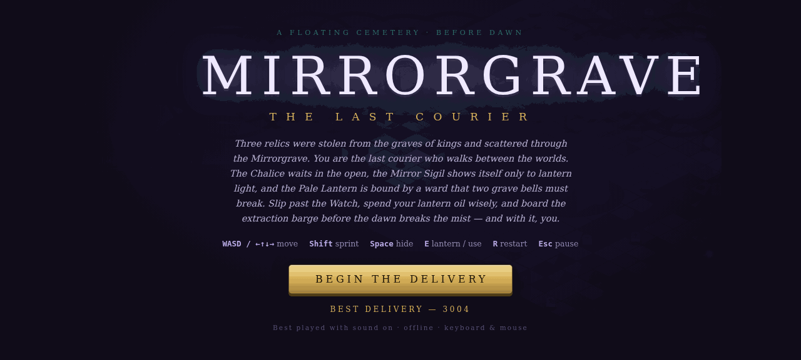

# Mirrorgrave: The Last Courier — Enhanced Edition

A 2.5D isometric stealth-adventure for the browser, built for the make.fun **best-game-01** bounty.
You are the last courier left walking the floating cemetery of the Mirrorgrave. Three relics were
stolen from the graves of kings; recover them all and board the extraction barge before dawn breaks
the mist — and with it, you.



## Run it

No build step, no network, no accounts. `game/` is plain static files served by any static HTTP server:

```sh
node serve.ts            # serves game/ on http://localhost:8080
# or: python3 -m http.server 8080 -d game
```

Open it in desktop Chrome, keyboard & mouse. `node main.ts` (make.fun grading contract) copies `game/`
and `screenshots/` to `/output` and writes `/output/dossier.json` with the kit's `vendor/makefun-game.ts`.

## The game

**Objective.** Find the three relics, then board the extraction barge at the southwest dock.
A six-minute dawn timer is always running. Being fully detected ends the run, as does sunrise.

**The three relics — three distinct trials.**
- **The Chalice of Lowfield** — lies in the Old Reliquary, watched. Pure stealth.
- **The Mirror Sigil** — shows itself only to lantern light; the dark hides it even from you.
- **The Pale Lantern** — bound by a spectral ward. Two grave bells must toll to break the seal.

**The lantern.** Light reveals what is hidden (relics, echoes, rune paths) and betrays you while lit:
your visibility range grows and nearby wardens notice. It also burns oil — spend it or be left rekindling
in the dark.

**Deeper stealth.** Wardens patrol, hear sprinting and puddle-splashing, investigate, sweep their gaze
while searching, can find you through thin cover when lingering, and radio their neighbours. Hiding beside
stone and in mist deepens concealment; sprinting and lantern light expose you. Bells ring as distractions.

**Secrets.** Three whispered echoes (lantern-revealed) and three epitaphs (lore + silver) hide in the
island; each is worth score. The HUD tracks them.

**Scoring.** Relics 400 each; time bonus 6/s remaining; ghost bonus for low peak detection; secrets
75/150. Best score persists in `localStorage`.

**Controls.** `WASD`/arrows move · `Shift` sprint · `Space` hide · `E` lantern / use · `R` restart · `Esc` pause.

## Screenshots

`screenshots/1-title.png` (title) · `screenshots/2-play.png` (in-game, HUD, lantern lit) · `screenshots/3-victory.png` (results)

## Layout

`game/index.html` — page shell + HUD + screens · `game/src/world.js` — the island, zones, relic
puzzles, bridge, secrets, collision · `game/src/guards.js` — warden AI (patrol/hear/search/shout) ·
`game/src/main.js` — loop, state, lantern energy, scoring · `game/src/render.js` — isometric renderer
(vector art, lighting, fog, puddles) · `game/src/audio.js` — generated WebAudio sound ·
`game/src/styles.css` — UI · `vendor/makefun-game.ts` — the bounty kit's library, unmodified.

License: MIT. `vendor/makefun-game.ts` is the make.fun kit's file, used as-is.
